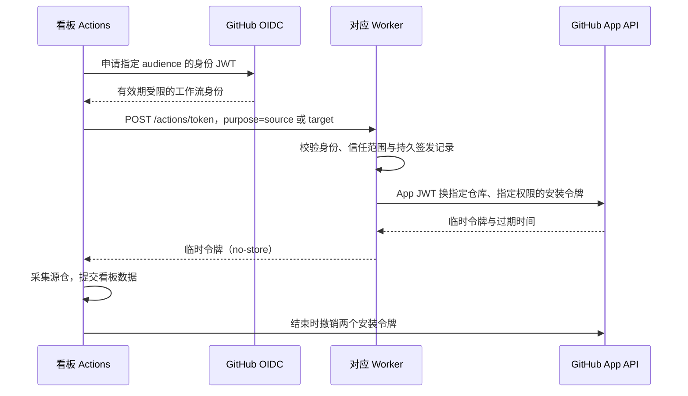

# Actions OIDC 临时凭据

## 功能与边界

App 私钥由对应环境的 Worker 管理。GitHub Actions 的工作流不读取 App 私钥，凭 GitHub 签发的 OIDC 身份向 Worker 换取安装令牌；哪个工作流能换哪些令牌、每个令牌对哪个仓库有什么权限，由管理页的「GitHub Actions 访问规则」决定。看板采集是其中一条规则，换两个令牌：源仓只读令牌、看板仓 Contents 写令牌。Bot 触发工作流所用的 Actions 写令牌只用于 dispatch，不作为工作流输入传递。

云端只有正式 Worker `sciencediscovery-bot`（`wrangler.jsonc`），正式看板仓向它兑换令牌；原测试 Worker 已删除，测试看板不再有兑换端。定时、手动与 Bot 触发均走同一流程；管理 Access 登录与 Actions OIDC 是两套独立认证。

## 配置

Worker 保留 `SDBOT_GITHUB_APP_ID` 和 Secret `SDBOT_GITHUB_APP_PRIVATE_KEY`，设置唯一 `SDBOT_REPOS`／`SDBOT_BOARD_TARGETS`，以及：

| 变量 | 内容 |
| --- | --- |
| `SDBOT_ACTIONS_AUDIENCE` | 本 Worker 的 OIDC audience，与看板仓 `SDBOT_TOKEN_AUDIENCE` 一致 |
| `SDBOT_ACTIONS_REPOSITORY_ID` | 看板仓不可变的数字 ID；用于生成第一条「看板采集」规则，以及 `/actions/gitcode-sync` 的身份校验 |
| `SDBOT_ACTIONS_OWNER_ID` | 看板仓所属组织不可变的数字 ID，用途同上 |
| `SDBOT_ADMIN_HOSTNAME` | 本 Worker 的指定域名，兑换端点也限制此域名 |

信任 ID 为非秘密部署配置，随 Wrangler 配置评审；实际部署标识不复制到公开说明。看板仓设置两个 **Actions Variables**：`SDBOT_TOKEN_BROKER_URL`（对应 Worker HTTPS 地址加 `/actions/token`）、`SDBOT_TOKEN_AUDIENCE`（与 Worker 一致）。采集 job 声明 `id-token: write`，其余默认 `GITHUB_TOKEN` 仍只有 Contents read。

看板仓不再需要 `SDBOT_GITHUB_APP_ID` 或私钥 Secret。完成新链路验证后删除旧私钥 Secret；删除仓库副本不等于撤销 App 私钥，不要误撤销 Worker 正在使用的密钥。先部署支持兑换的 Worker，再更新相应看板工作流，先测试后正式。

## 访问规则

管理页「外部调用」下方的「GitHub Actions 访问规则」列出允许兑换令牌的工作流，最多 20 条。每条规则：

- **名称**；
- **工作流所在仓库**：填 `owner/name`，保存时 Worker 向 GitHub 查询并固定它不可变的仓库 ID 和所有者 ID（App 安装在该仓库时用 App 读取，私有仓库也可以；否则读公开接口；都读不到时拒绝保存）。之后按 ID 识别：仓库改名或转移后仍匹配，有人用旧名字新建的仓库不匹配；修改规则时仓库不变就沿用原来的 ID。填写后可以先点旁边的「校验」，页面立即显示 GitHub 上的规范名称、两个 ID，以及 GitHub App 是否安装在该仓库，名称写错时当场提示；
- **工作流文件**：`.github/workflows/` 下的文件，例如 `.github/workflows/collect.yml`；
- **分支**：只接受这个分支上运行的工作流，默认 `main`；
- **允许的触发事件**：`schedule`、`workflow_dispatch`、`push`、`release`、`workflow_run`、`repository_dispatch` 中的一个或多个。`pull_request`、`pull_request_target`、`merge_group`、评论等会运行外部代码或输入的事件不提供；
- **令牌**：1 到 10 个，每个有用途名、目标仓库和权限。用途名就是请求里的 `purpose`，是 Bot 自己的名字，不是 GitHub 的规范：小写字母开头，只能用小写字母、数字、`-`、`_`，最多 32 个字符，规则内不重复。**用途名可以留空**：留空的令牌接受任意 `purpose`，请求也可以不带 `purpose`；每条规则最多一个留空的令牌，有同名的令牌时优先用同名的。目标仓库旁也有「校验」，会提示 GitHub App 是否安装在那里（没装时兑换会失败）。权限用和证书客户端相同的「权限名称／说明／读写·只读·禁止」选择器，见[外部调用](caller-api.md#令牌权限)。不同令牌可以指向不同仓库、给不同权限。

第一次读取规则时，Worker 用看板配置（`SDBOT_BOARD_TARGETS` 的唯一映射和上面两个 ID）生成「看板采集」规则：看板仓的 `collect.yml`、`main` 分支、`schedule` 与 `workflow_dispatch`，令牌 `source`（源仓）和 `target`（看板仓）。权限沿用上一版「GitHub Actions 看板采集令牌」条目保存过的选择，没保存过就用默认值。这只做一次：之后删除这条规则不会被重新生成，删除或收窄它会让看板采集失败。

管理接口与证书客户端相同：`GET`／`POST /admin/api/actions-rules`，`PUT`／`DELETE /admin/api/actions-rules/<id>`，经 Access 校验，只接受同源 JSON 写入，其他方法 405；参数不合法、仓库读不到或超过 20 条时返回 422。`GET` 同时返回可选事件、权限目录和上限。「校验」按钮调用只读的 `GET /admin/api/repository-identity?repository=owner/name`，返回规范名称、仓库 ID、所有者 ID 和 `app_installed`；读不到为 404，格式不对为 422。它在 Worker 入口直接查询 GitHub，不经过后台对象，什么也不保存。

## 接口与授权

`POST /actions/token` 使用 `Authorization: Bearer <GitHub OIDC JWT>`，JSON 请求为 `{"purpose": "用途名"}`，或 `{}`／空正文（只能换到规则里用途名留空的令牌）。仓库和权限都由匹配到的规则决定，请求方不能指定仓库或扩大权限。

- 固定 issuer 与 JWKS 地址、RS256、有效期、签发时间、`SDBOT_ACTIONS_AUDIENCE`；不跟随认证请求重定向；只接受指定域名。
- 匹配规则时同时校验：令牌中的仓库 ID 和所有者 ID 与规则一致；`ref` 是规则分支，`ref_type` 为 branch；`workflow_ref` 是该仓库的规则工作流文件；事件类型在规则允许的列表里；subject 为 GitHub 的原名称格式或包含不可变 ID 的格式。GitHub 的直接执行任务也可能包含 `job_workflow_ref`，该字段存在时必须仍指向同一个工作流文件，引用其他仓库或文件的可复用工作流会被拒绝。
- 身份不匹配任何规则为 403 `forbidden`；规则匹配但既没有同名令牌、也没有用途名留空的令牌时为 403 `purpose not allowed for this workflow`；`purpose` 格式不对或请求还有其他字段为 400。
- Durable Object 原子记录规则／仓库／run／attempt／令牌；每次运行尝试每个令牌只能兑换一次（409）。用途名留空的令牌不论请求写什么 `purpose` 都按同一个令牌计，换个名字也不能多拿。记录保留至少一天，过期记录在后续请求中清理；不保存 JWT、安装令牌或私钥。跨组织分别换取 installation 令牌。
- 默认的看板采集权限：源仓令牌 Metadata、Contents、Issues、Pull requests、Actions、Checks、Commit statuses 只读；看板令牌 Metadata 只读、Contents 读写。选了 App 安装没有获批的权限时 GitHub 不签发，兑换返回 502。
- 每次成功签发后，另在发放记录表写一条：来源 `actions`，身份为「规则名 · 仓库 run 编号#attempt」，`purpose`（请求没带时记为 `*`）、实际仓库、所申请的权限和 GitHub 返回的令牌到期时间，不含令牌；管理页「外部调用」与证书兑换一起列出，保留 60 天、至多 1000 条。写记录失败时令牌照常返回。见[外部调用](caller-api.md)。

`POST /actions/gitcode-sync` 使用同一身份校验（不需要请求体，也不受每次运行一次的限制），只返回本看板源仓的 GitCode 同步记录，不签发令牌、不进入 Webhook 档案；同步未启用时返回 `enabled: false`。见 [GitHub PR 同步到 GitCode](gitcode-sync.md)。

`POST /actions/reruns` 与 `POST /actions/reruns/ack` 也不签发令牌、不进入投递档案，只允许既有看板配置中的固定采集身份：仓库与所有者 ID、`main`、`.github/workflows/collect.yml`、`schedule`／`workflow_dispatch`、固定 audience 和管理域名；其他访问规则不能借此查询待办，新增接口不扩大 OIDC 信任范围。读取请求为 `{}`，返回 `{"ok":true,"source":"owner/source","runs":[{"id":123,"attempt":2,"revision":"32位小写十六进制"}]}`，最多 20 条。确认请求为 `{"commit":"已提交的40位小写SHA","runs":[原样成功项]}`，正文上限 4096 字节；仅删除版本仍匹配的项。客户端必须在公开数据和进度提交成功后确认，并重新申请短期 OIDC 身份，避免长采集结束时原 JWT 已过期。接口不受令牌兑换次数限制，失败不清待办；响应均为 `no-store`。见 [CI 重跑通知](board-publication.md#ci-重跑通知)。

成功返回 `token`、`expires_at`、`repository`、`purpose`（请求没带时为 null）、`permissions`，响应 `Cache-Control: no-store`。认证失败为 401，身份超出信任范围为 403，重复兑换为 409，配置不完整为 503，上游签发失败为 502。发布新版本后的几分钟内，Worker 的后台对象可能还在运行旧代码，这时返回 503 且带 `Retry-After: 60` 和 `retryable: true`，稍后重跑即可。错误只返回短说明，不透传上游响应。该端点及 `/actions/` 保留路径不进入 Webhook 档案；它也不能查询管理信息。

## 采集器与失败恢复

看板仓 `collect_with_oidc.py` 从 Actions 运行环境获取 OIDC 身份，申请并立即遮蔽两个安装令牌；子进程只收到采集需要的两个令牌，不收到 OIDC 请求凭据或 App 私钥。它仍调用原有 `publish.py --incremental`，不会重置 `.sync/` 或 `site/`。

正常退出和可捕获失败都会尝试撤销已领取令牌，包含只成功领取第一个令牌的情况。Runner 被强制终止或撤销请求失败时，令牌由 GitHub 的有效期兜底。令牌不作为工作流输出、artifact 或持久缓存。

签发前先占用运行尝试的配额；上游失败或响应丢失后不允许在同一个 attempt 反复签发。使用 GitHub **Re-run jobs** 或下一个采集运行恢复，不能复用旧 OIDC 身份。失败不回退到长期私钥或个人令牌。Worker 不可用时本轮采集失败，已发布页面和历史保留。

## 验证

Bot：`npm run check`、`npm test`；`tests-ts/actions-auth.test.mjs` 在真实 workerd 中验证签名、跨环境拒绝、由看板配置生成的规则及其默认权限、并发重复、重启后签发记录及凭据不归档；另一条规则的多个令牌各按自己的仓库和权限申请；用途名留空的令牌接受任意 `purpose` 或不带 `purpose`、每次运行只发一次、同名令牌优先、没有留空令牌的规则不接受空 `purpose`；事件、分支、工作流文件、可复用工作流、仓库 ID 和所有者 ID 不符时 403，仓库改名后按 ID 仍能兑换，删除规则后不再兑换且重启不会重新生成。`tests-ts/worker-caller.test.mjs` 验证规则的管理接口：生成规则时沿用上一版保存的权限、查询并固定仓库 ID、仓库不变时不重新查询、留空用途名最多一个、校验接口的结果与 404／422／405／401、各种非法输入的 422、405、跨站 403、非 JSON 415 与未认证 401。看板：`python3 -m unittest discover -s tests -v`，包含凭据隔离、撤销、部分失败、拒绝重定向及错误脱敏。实际上线还需验证 GitHub runner 的真实 OIDC 及 App 提交身份。

参考：[GitHub OIDC 身份字段](https://docs.github.com/en/actions/reference/security/oidc)、[安装令牌撤销](https://docs.github.com/en/rest/apps/installations#revoke-an-installation-access-token)。
