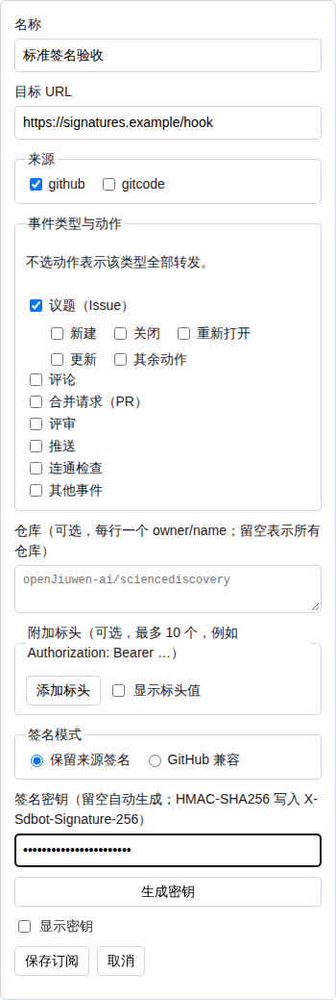
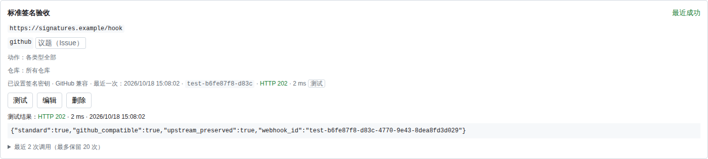

# Webhook 转发

## 功能

正式 Worker 可以把收到的 Webhook 原样转发给其他 HTTPS 服务。转发订阅在 Access 保护的管理页「转发」中增删改查，最多 20 条。Node 本机运行不提供这项功能。

每条订阅包含：

- **名称**；
- **目标 URL**：只接受 `https`；
- **来源**：`github`、`gitcode` 或两者；
- **事件类型**：可多选 `issue`、`issue_comment`、`pull_request`、`pull_request_review`、`push`、`ping`、`other`。类型是归一化后的 kind，`other` 表示这六类之外、已经归档的事件，例如 `workflow_run`、`installation` 或未识别的事件；
- **动作**（可选）：在对应事件类型下面选择，使用下表的 `类型:动作` 值；不选表示该类型全部转发，旧订阅没有 `actions` 时行为不变；
- **仓库**（可选）：一组 `owner/name`，最多 50 个，不区分大小写；留空表示所有仓库；
- **附加标头**（可选）：最多 10 个，例如 `Authorization: Bearer <令牌>`，用于目标服务的鉴权；
- **签名密钥**：可手填旧密钥，或点击「生成密钥」。留空保存时生成 `whsec_` 加 32 字节随机数的 base64；旧的空密钥订阅首次发送时仅初始化一次。
- **签名模式**：保留来源签名（`preserve`）或 GitHub 兼容（`github-compatible`）。

## 转发规则

- **只转发已验签并归档成功的投递**：
  - 状态为 `accepted` 的投递会转发；
  - 不在 `SDBOT_REPOS` 范围而记为 `ignored` 的投递也会转发；
  - 验签失败或请求无效的投递不转发；
  - 同一 delivery id 的重复投递只自动转发第一次；管理页可以独立重新转发归档原文，不重新执行入库管道和业务监听器。
- **发送时机**：在归档事务提交之后，用 `waitUntil` 在后台发出，Webhook 的响应不等待转发。
- **请求格式**：方法为 `POST`，正文保持收到的原始字节。先复制来源业务标头，保留来源的 `User-Agent`、`Content-Type`、`X-GitHub-*`、`X-GitCode-*` 和平台签名。再按名称不区分大小写、只在缺失时追加：
  - `Content-Type: application/json`；
  - `User-Agent: sciencediscovery-bot-forward`；
  - `X-Sdbot-Provider`；
  - `X-Sdbot-Event`：归一化后的 kind；
  - `X-Sdbot-Delivery`：平台 delivery id，没有时用记录 id；
  - `X-Sdbot-Action`：归一化动作，允许为空。
- **不复制的来源标头**：`Content-Length`、`Host`、`Connection`、`Keep-Alive`、`Transfer-Encoding`、`TE`、`Trailer`、`Upgrade`、`Expect`、`Content-Encoding`、`Cookie`；`webhook-id`、`webhook-timestamp`、`webhook-signature`；以 `Proxy-`、`CF-`、`Sec-`、`X-Sdbot-` 开头的名称；以及 `Forwarded`、`Via`、`X-Forwarded-For`、`X-Forwarded-Proto`、`X-Forwarded-Host`、`X-Forwarded-Port`、`X-Real-IP`、`True-Client-IP`、`CDN-Loop`。连接、基础设施和客户端 IP 标头不传到目标；不带 `Content-Encoding`，因为发送的是接收器实际捕获到的字节。
- **动作过滤**：先匹配来源、事件类型和仓库，再匹配该类型已选动作。`actions` 缺省或为空时不限制动作；非空时，仍只有选了动作的类型受限制。例如订阅同时选择 Issue 和 PR，只选 `issue:opened`，则只限制 Issue 为新建，PR 继续全部转发。动作不能扩大事件类型范围，未选择对应类型、未知动作、非数组均返回 422。只使用归档记录的 `kind`、`action`、`extra.on`，不重新解析正文。已合并 PR 只匹配 `pull_request:merged`，不匹配 `pull_request:closed`。
- **仓库过滤**：订阅填了仓库时，只转发这些仓库的投递，按归一化后的仓库名（GitHub 的 `full_name`、GitCode 的项目路径）不区分大小写比较。不在 `SDBOT_REPOS` 范围、记为 `ignored` 的投递，只要仓库在订阅列表里也会转发。没有仓库的投递（例如 App 级别的 `installation`）只发给未填仓库的订阅。
- **附加标头**：只在名称尚不存在时追加，不能覆盖来源值。名称须是合法的 HTTP 字段名，同名（不区分大小写）不能配置两次；值最长 1024 个字符，不能含换行或其他控制字符。不能配置连接类标头、`Cookie`、`Content-Type`、`User-Agent`、`X-Hub-Signature-256`、`X-GitCode-Signature-256`，`webhook-id`、`webhook-timestamp`、`webhook-signature`，以及所有 `X-Sdbot-*`、`Proxy-*`、`CF-*`、`Sec-*` 名称。`Authorization` 等非保留标头可以配置，但来源已有同名值时来源优先。
- **中继签名**：每次发送都覆盖 `webhook-id`、`webhook-timestamp`、`webhook-signature`。具体算法、兼容模式和接收方验证见下文；`X-Sdbot-Signature-256` 仍是订阅密钥原始 UTF-8 字节对正文的 HMAC-SHA256，格式为 `sha256=<hex>`。
- **超时与重定向**：单次超时 5 秒，不跟随重定向，3xx 记为失败。
- **持久重试**：网络错误、超时、408、429 和 5xx 在首次失败后最多 24 小时重试；401 及其他 4xx、3xx 和非法目标不重试。Webhook 仍按来源平台原来的状态确认，不等待下游重试。
- **目标地址检查**：只接受 `https`，URL 中不能带用户名或密码。以下目标会被拒绝：
  - `localhost`、`*.localhost`、`*.local`、`*.internal`，以及 `metadata.google.internal` 等云元数据主机名；
  - 字面 IP 落在回环、私网（10/8、172.16/12、192.168/16）、CGNAT 100.64/10、链路本地（含 169.254.169.254）、0/8、组播或保留段的主机；
  - IPv6 的 `::1`、`fc00::/7`、`fe80::/10`，以及映射到上述 IPv4 段的地址。

  `https://2130706433/` 这类整数写法会先被 URL 解析规范为点分地址再检查。保存时和每次发送前都会检查。主机名的 DNS 解析由 Cloudflare 出站完成，Worker 无法在发送前解析名称，因此这里只检查字面地址。
- **存储内容**：不再另存 Webhook 正文。每条订阅保存配置和最近 20 次调用结果（含测试，新的在前），每次记录时间、delivery id、事件类型、仓库、耗时，以及 HTTP 状态或错误摘要（`HTTP 500`、`redirect not followed (HTTP 302)`、`timed out after 5 s`、`network error`）。编辑订阅不清空这些结果；删除订阅时一并删除。升级前保存的单条结果作为第一条历史保留，没有耗时、类型和仓库。

## 动作取值

管理页每个类型和动作标签的悬浮说明与本文分类一致，悬浮在文字或复选框上即可查看。

| 事件类型 | actions 取值与含义 |
| --- | --- |
| `issue` | `issue:opened` 新建、`issue:closed` 关闭、`issue:reopened` 重新打开、`issue:edited` 更新、`issue:other` 其余动作 |
| `pull_request` | `pull_request:opened` 新建、`pull_request:closed` 关闭但未合并、`pull_request:reopened` 重新打开、`pull_request:edited` 更新、`pull_request:synchronize` 新提交、`pull_request:merged` 合并、`pull_request:other` 其余动作 |
| `issue_comment` | `issue_comment:issue` 议题评论、`issue_comment:pull_request` 合并请求评论、`issue_comment:other` 其他评论；按 `extra.on` 归类 |
| `pull_request_review` | `pull_request_review:submitted` 提交评审、`pull_request_review:edited` 更新评审、`pull_request_review:dismissed` 撤销评审、`pull_request_review:diff_comment` 代码行评论、`pull_request_review:other` 其他评审；`extra.on=diff_comment` 优先归为代码行评论 |

`push`、`ping`、`other` 不设动作。GitHub 和 GitCode 使用同一套归一化值。管理页使用中文标签，动作放在所属类型下面；取消类型勾选时不提交该类型动作。

## 签名与兼容模式

Standard Webhooks 三个标头总是由 Bot 生成，来源的同名标头被丢弃，附加标头也不能配置这些名字：

- `webhook-id` 与 `X-Sdbot-Delivery` 相同；同一次投递的重试保持不变。
- `webhook-timestamp` 是本次尝试的 Unix 秒，每次重算。
- `webhook-signature: v1,<base64>`：对 UTF-8 的 `${id}.${timestamp}.` 加上实际发出的原始正文字节做 HMAC-SHA256。`whsec_` 密钥先将后缀 base64 解码；旧密钥按原始 UTF-8 字节使用。

| 标头 | 保留来源签名 `preserve` | GitHub 兼容 `github-compatible` |
| --- | --- | --- |
| `webhook-signature` | Standard Webhooks 中继签名 | Standard Webhooks 中继签名 |
| `X-Sdbot-Signature-256` | 订阅密钥对正文的 `sha256=<hex>` | 同左 |
| `X-Hub-Signature-256` | 仅保留来源值；来源没有就不出现 | 始终是订阅密钥对正文的 `sha256=<hex>` |
| `X-GitCode-Signature-256` | 仅保留来源值；来源没有就不出现 | 始终是订阅密钥对正文的 `sha256=<hex>` |
| `X-Sdbot-Source-Signature-256` | 不生成 | 上游原 `X-Hub-Signature-256`，原来没有就不生成 |
| `X-Sdbot-Source-GitCode-Signature-256` | 不生成 | 上游原 `X-GitCode-Signature-256`，原来没有就不生成 |

新建订阅默认 `preserve`。旧订阅没有 `signature_mode` 时，`created` 早于 `2026-10-18T09:02:44Z` 的按 `github-compatible` 解释，其余按 `preserve` 解释。管理页显示实际模式，下次保存写入显式字段，不在启动时扫表改写。模式选项有中文悬浮说明。省略密钥的编辑保留已有密钥；明确清空后保存会生成新密钥。

接收方优先用官方 [Standard Webhooks 库](https://github.com/standard-webhooks/standard-webhooks/tree/main/libraries)验证中继签名。旧密钥选择 raw 格式，包含非 ASCII 字符时传 UTF-8 字节；`whsec_` 直接按标准格式使用。校验实际收到的正文，检查时间戳容差（官方库默认 5 分钟），成功后按 `webhook-id` 去重。同一 ID 的重复通知确认成功即可，不重复执行业务。

保留下来的上游签名只是来源信息，不能默认拿订阅密钥验证。多个已支持的签名头并存时，任一能用接收方自己的密钥验过即可；仍须独立执行接收协议的时间戳容差和去重。不要因为先看到一个上游签名就判定中继签名无效。只支持 GitHub 风格验签的接收方选择 `github-compatible`。

下图使用隔离示例，展示窄屏的模式配置和桌面的测试结果；接收方同时验证了标准签名和 GitHub 兼容签名。

## 重试与重新转发

首次发送仍在归档成功后通过 `waitUntil` 执行。只有可恢复失败才创建重试行，初始间隔 30 秒，随后 60、120 秒依次翻倍，上限 1 小时，下一次尝试超过首次失败后 24 小时就停止。重试仍使用当前订阅配置；未修改密钥时，正文字节和 `X-Sdbot-Signature-256`／兼容平台签名不变，标准时间戳和标准签名每次重算。

重试由现有 Durable Object 的同一个 Alarm 执行，保留看板、GitCode 同步和转发中更早的到期任务。每批最多领取 10 个任务，使用 2 分钟租约恢复进程重启中的工作；出站请求不占入库互斥锁。成功首投不查询重试表，仍只更新已有的订阅结果行。重试行只保存归档引用、投递 ID、尝试数、截止时间和内部来源标头，不另存正文或订阅密钥；重试读取已有 R2 正文。正文已删除则记失败并停止。删除订阅会删除其待重试任务；最近 20 次调用显示每次尝试和下一次时间。接收方需容忍进程故障导致的重复尝试。

归档详情的「重新转发」调用 `POST /admin/api/events/<record_id>/forward`：向当前匹配的订阅发送归档原文，生成 `manual-<record_id>-<8位随机>` 的新中继 ID，各订阅共享该次手动操作的 ID。它不重新验签入库、不更新业务监听器、不创建新投递档案；自动去重保持原样。只允许原来已接受或范围外忽略的投递，拒绝的请求不升级为可信中继。没有匹配订阅返回 422，正文或档案已不可用返回 404；成功安排返回 202，不等于下游已经接收成功。

档案中的凭据和上游签名早已脱敏；手动操作只能使用保留的非敏感来源标头，不发送 `[REDACTED]`，不伪造已丢失的上游签名。新的中继签名仍可验证。正常自动重试则从首次失败任务保留的内部标头恢复原上游签名。

## 测试与调用记录

订阅卡片上的「测试」立即向目标发送一条测试请求，用来确认地址、鉴权标头和签名配置可用：
- **请求内容**：方法、地址及附加标头规则与真实转发相同，并带 GitHub 示例来源标头（`User-Agent: GitHub-Hookshot/test`、`X-GitHub-Event: ping`、`X-GitHub-Delivery` 和一个明确不是订阅密钥生成的 `X-Hub-Signature-256`）；`X-Sdbot-Provider` 为 `test`，`X-Sdbot-Event` 为 `ping`，`X-Sdbot-Delivery` 为 `test-<uuid>`，并额外带 `X-Sdbot-Test: 1`。`X-Sdbot-Action` 为空；标准签名和模式规则与真实 GitHub 转发完全一致；`preserve` 保留伪造上游签名，`github-compatible` 才把平台标头换成订阅签名。正文仍是一小段 JSON：`{"test": true, "zen": "...", "subscription": {"id", "name"}, "sent_at"}`；
- **不受筛选限制**：订阅的来源、事件类型、动作和仓库筛选不影响测试；
- **结果**：页面在卡片上显示 HTTP 状态或错误、耗时和时间，以及目标返回内容的开头。返回内容最多读取 4 KB，签名密钥和附加标头的值被替换为 `[REDACTED]`，再按常见令牌格式脱敏，最多显示 500 个字符；它只出现在这次测试的响应里，不保存；
- **记录**：测试结果和真实转发一样计入最近 20 次调用，并标记「测试」。测试请求不是 Webhook，不进入投递归档。测试失败同样按重试策略处理；仅保存固定示例的名称、时间和 ID 以重建相同 JSON，不另存正文或返回内容。这是签名路径测试，不是历史投递重放。

卡片下方的「最近 N 次调用」展开后逐条显示时间、结果、耗时、事件类型、仓库和 delivery id。数据随订阅列表一起读取，测试完成后只更新这张卡片，不另外刷新列表。

## 密钥与可见范围

签名密钥和附加标头的值（常常是令牌）保存在 Bot 的 Durable Object 中，只能通过 Access 认证后的 `GET /admin/api/forwards` 读回，用于编辑时核对。它们不会进入日志、`/admin/api/status`、`/admin/api/usage`、投递记录或 Webhook 响应。管理页的订阅卡片只显示标头名称；编辑表单中的标头值默认遮住，勾选「显示标头值」才显示。

## 管理接口

| 方法与路径 | 用途 |
| --- | --- |
| `GET /admin/api/forwards` | 订阅列表（含密钥、最近 20 次结果 `recent` 和最近一次 `last`）、上限 `limit` 与保留条数 `history` |
| `POST /admin/api/forwards` | 新建，成功返回 201 |
| `PUT /admin/api/forwards/<id>` | 修改 |
| `DELETE /admin/api/forwards/<id>` | 删除 |
| `POST /admin/api/events/<record_id>/forward` | 当前匹配订阅的独立重新转发；返回 202／422／404 |
| `POST /admin/api/forwards/<id>/test` | 发送测试请求，等待目标答复（最多 5 秒）后返回 `{ ok, result, response_excerpt }`；订阅不存在时 404 |

这些接口先经过 `authorizeAdmin`。写请求还必须满足两点，用来防止跨站写入：
- 正文是 `application/json`，否则返回 415；
- 请求带 `Origin` 时必须与管理页同源，带 `Sec-Fetch-Site` 时必须是 `same-origin`，否则返回 403。

参数不合法或已达 20 条时返回 422。集合路径只接受 GET／POST，单条路径只接受 PUT／DELETE，测试路径只接受 POST（正文为任意 JSON，例如 `{}`），其他方法返回 405。

## 主要实现与成本

- `src/core/forward.ts`：地址检查、参数校验、类型匹配、发送和测试请求。
- `src/worker/forward.ts`：SQLite 表 `forward_subscriptions`。订阅列表在 Durable Object 生命周期内只读一次并缓存在内存，所以每次 Webhook 不增加 SQLite 读取；只有实际转发或测试时，才会改写该订阅所在的一行（最近结果放在同一行里），不增加行数。
- `src/worker/index.ts`：在归档成功后调用转发，并提供管理路由。
- 页面没有新增定时器：打开页面、切换到「转发」或点击刷新时才读取。

## 验证

`tests-ts/worker-forward.test.mjs` 在 workerd 中验证：
- 私网和元数据地址被拒绝；
- 官方 `standardwebhooks` 验证 `whsec_` 与旧 UTF-8 密钥、两种模式、带上游签名的测试、旧订阅模式迁移及标准标头不可伪造；
- 持久重试跨重启、503→202 的 ID 和原文不变、401 不重试、24 小时截止、正文缺失、入库锁隔离、共享 Alarm 不后推、成功首投无新 SELECT，以及管理重新转发的鉴权／同源／JSON 限制；
- 来源／类型／动作筛选与旧订阅兼容：Issue 新建不包含关闭，未选 PR 动作时 PR 不受限，合并不匹配关闭，GitCode MR 评论及评审代码行评论按归档字段匹配；
- 原始正文字节及来源 User-Agent、Content-Type、GitHub／GitCode 事件和平台签名保留，连接与基础设施标头剔除，同名附加标头不覆盖来源，订阅签名使用新标头且平台标头遵循所选模式；
- 目标返回 500、302 和超时时 Webhook 仍返回 200，并记录各自的结果；
- 验签失败和重复投递不转发；
- 密钥不进入状态和用量接口；
- 20 条上限、405、跨站 403 和未认证 401；
- 按仓库过滤（不区分大小写，含范围外仓库）、附加标头送达目标且不出现在状态、用量和投递接口中，以及非法字段名、含换行的值、保留标头、重复名称和超过 10 个标头时的 422；
- 测试请求带 `X-Sdbot-Test`、附加标头和正确签名，且不受筛选限制；目标返回 500 并回显凭据时，结果为 `HTTP 500`，摘要已脱敏且不超过 500 字符，测试不进入投递归档；
- 最近结果包含真实转发和测试，新的在前，超过 20 条丢弃最旧的，编辑后保留；
- 测试路径的 405、未知订阅 404、跨站 403、非 JSON 415 和未认证 401，被拒绝的请求不会发到目标。

浏览器旅程 `test/journey-cloud-admin.spec.cjs` 另外以真实 workerd 和隔离接收端验证：`preserve` 的标准签名通过、旧 GitHub 风格校验失败；切换 `github-compatible` 后两种验证同时通过，上游签名已迁移；归档详情重新转发生成新 ID，最近调用出现该次真实转发。

同一旅程在 390px 下完成配置（含按类型动作、仓库和 `Authorization` 标头，值默认遮住、卡片只显示名称），编辑回显动作、取消类型后不提交对应动作、清空动作恢复该类型全部后，点击「测试」看到 `HTTP 503`、耗时和「返回内容为空」，展开最近调用并在第二次测试后仍保持展开，在 390px 和桌面宽度下都没有横向溢出，并确认加载后没有定时请求。
